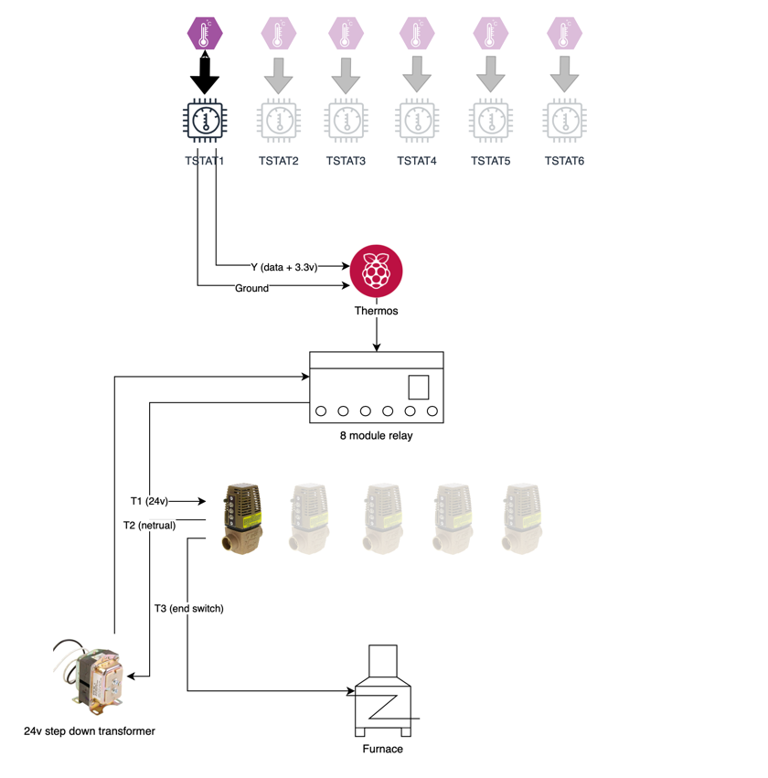

# ThermOS
## HomeKit Thermostat for Hydronic Heating Systems

ThermOS is a HomeKit-enabled thermostat designed specifically for multi-zone hydronic heating systems running on Raspberry Pi.



## Features
- **HomeKit Integration**: Control your heating natively through Apple Home.
- **Multi-Zone Support**: Manage multiple heating zones from a single Raspberry Pi.
- **Hardware Abstraction**: Supports local DS18B20 temperature sensors and generic GPIO relays.
- **Remote Sensors**: Can poll remote HTTP endpoints for temperature data if wiring is difficult.
- **Prometheus Metrics**: Built-in metrics for temperature and system status monitoring.

## Prerequisites

### Hardware
- **Raspberry Pi**: Any model with GPIO headers (Pi Zero W, 3B+, 4, etc.).
- **Relay Module**: 5V Relay module compatible with Raspberry Pi GPIO (Active High/Low logic is handled in code, default High).
- **DS18B20 Temperature Sensors**: One for each zone.
- **Wiring**: 
    - Connect Relays to GPIO pins.
    - Connect DS18B20 sensors to GPIO pin 4 (default for 1-wire) or other configured pin.
    - Ensure `w1-gpio` overlay is enabled in `/boot/config.txt`.

### Software
- **Docker**: For containerized deployment.
- **Docker Compose**: For orchestrating the services.
- **Git**: To clone the repository.

## Installation

1. **Clone the Repository**
   ```bash
   git clone https://github.com/truncj/thermos.git
   cd thermos
   ```

2. **Configure the System**
   Create a `config/config.json` file. You can see `config/config.json.example` if available, or use the format below:

   ```json
   {
       "system": {
           "vcc_pin": 22
       },
       "Living Room": {
           "relay_pin": 17,
           "temp_pin": 4,
           "temp_id": "28-00000xxxxxxx"
       },
       "Bedroom": {
           "relay_pin": 27,
           "temp_pin": 4,
           "temp_id": "28-00000yyyyyyy"
       }
   }
   ```
   - **system.vcc_pin**: (Optional) GPIO pin powering the sensors. Defaults to 22.
   - **relay_pin**: BCM pin number controlling the relay for this zone.
   - **temp_pin**: BCM pin for 1-wire data (usually 4).
   - **temp_id**: The unique ID of the DS18B20 sensor (check `/sys/bus/w1/devices/`).
   - **extra_sensor**: (Optional) URL to fetch temp from a remote sensor (JSON response `{"temp_c": 21.5}`).

3. **Start with Docker Compose**
   ```bash
   docker-compose up -d --build
   ```

   This will start:
   - **Thermos**: The main application.
   - **Redis**: For state persistence.
   - **Prometheus**: For metrics collection.
   - **Grafana**: For visualizing metrics (localhost:3000).

4. **Pair with HomeKit**
   - Open the **Home** app on your iOS device.
   - Tap **Add Accessory**.
   - Scan the QR code printed in the logs (view with `docker logs -f thermos`) or manually enter the code (default is often `518-26-xxx` if not specified, check HAP-python docs or logs).

## Development

To run locally without Docker for development:

1. **Install Dependencies**
   ```bash
   python3 -m venv venv
   source venv/bin/activate
   pip install -r requirements.txt
   ```

2. **Run**
   ```bash
   python3 main.py
   ```
   *Note: On non-Raspberry Pi systems, GPIO and Sensors will be mocked.*

## Monitoring

- **Prometheus**: `http://<pi-ip>:9090`
- **Grafana**: `http://<pi-ip>:3000` (Default login: admin/admin)
- **Metrics**: `http://<pi-ip>:8080/metrics`

## License
MIT
